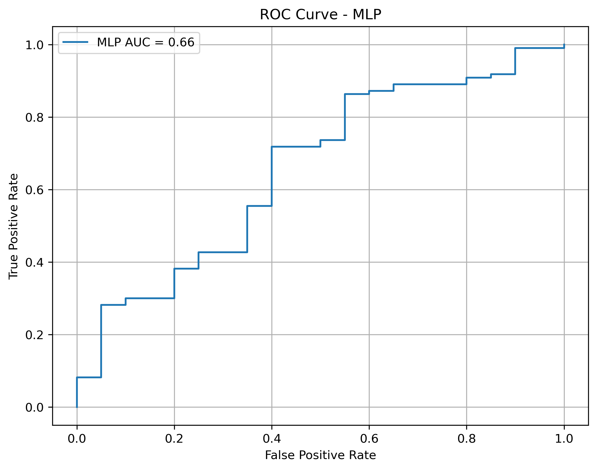
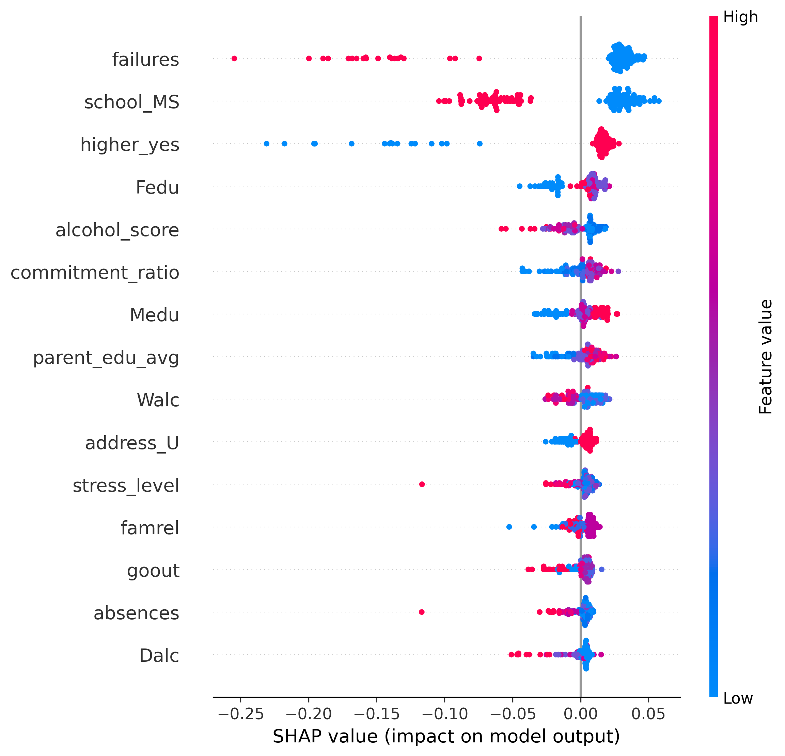
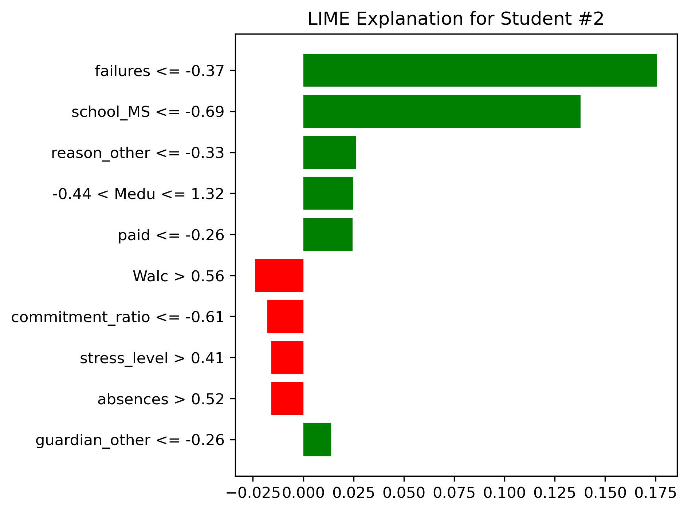

# 🎓 Student Performance Prediction with Explainable AI (XAI)

## Overview

This project investigates the use of Machine Learning and Explainable Artificial Intelligence (XAI) techniques to predict student academic performance. The objective is to identify students at risk of poor academic outcomes and provide interpretable insights into the factors influencing predictions.

The project was developed as part of an MSc Dissertation and evaluates multiple machine learning models alongside SHAP and LIME explainability methods.

---

## Research Objectives

* Predict student academic performance using machine learning models.
* Compare model performance across multiple algorithms.
* Address class imbalance using SMOTE.
* Improve model interpretability using Explainable AI techniques.
* Identify key factors contributing to student success or failure.

---

## Dataset

The project uses the **UCI Student Performance Dataset** (Portuguese language course file, `student-por.csv`, 649 students), which contains demographic, social, academic, and behavioural attributes of secondary school students.

Key features include:

* Age
* Study Time
* Absences
* Previous Failures
* Alcohol Consumption
* Family Educational Background
* School Support Programs
* Social and Lifestyle Factors

Target Variable:

* **Pass (1)** → Final grade ≥ 10
* **Fail (0)** → Final grade < 10

---

## Feature Engineering

Several new features were created to improve predictive performance:

| Feature          | Description                                       |
| ---------------- | ------------------------------------------------- |
| study_efficiency | Study time relative to travel time                |
| parent_edu_avg   | Average parental education level                  |
| support_score    | Combined academic support indicators              |
| alcohol_score    | Combined weekday and weekend alcohol consumption  |
| stress_level     | Study time + travel time + absences               |
| commitment_ratio | Study time relative to free time                  |
| high_risk        | Students with high absences and multiple failures |

---

## Machine Learning Models

The following models were evaluated:

1. Random Forest
2. Random Forest with SMOTE
3. Support Vector Machine (SVM)
4. Multi-Layer Perceptron (MLP)

---

## Technologies Used

* Python
* Pandas
* NumPy
* Scikit-Learn
* Imbalanced-Learn (SMOTE)
* Matplotlib
* SHAP
* LIME

---

## Results

### ROC Curve



### SHAP Summary Plot



### LIME Explanation



---

## Model Performance

| Model                 | Accuracy | F1 Score | Recall | Precision |
| --------------------- | -------- | -------- | ------ | --------- |
| Random Forest         | 0.83     | 0.91     | 0.95   | 0.86      |
| Random Forest + SMOTE | 0.79     | 0.88     | 0.90   | 0.86      |
| SVM                   | 0.79     | 0.88     | 0.90   | 0.86      |
| MLP                   | 0.79     | 0.88     | 0.87   | 0.88      |

The Random Forest model achieved the highest overall performance and was selected for explainability analysis.

---

## Explainable AI (XAI)

### SHAP

SHAP (SHapley Additive exPlanations) was used to identify globally important features influencing model predictions.

Key observations:

* Previous failures strongly impact performance predictions.
* Alcohol consumption influences academic outcomes.
* Family educational background contributes positively.
* Study behaviour and support systems affect student success.

### LIME

LIME (Local Interpretable Model-Agnostic Explanations) was used to explain individual student predictions by highlighting the factors contributing to a specific prediction.

This enables local-level interpretability and supports educational intervention strategies.

---

## Repository Structure

```text
student-performance-prediction-xai/
├── README.md
├── requirements.txt
├── src/
│   └── student_performance_xai.py   # place student-por.csv here
├── results/
│   ├── roc_curve.png
│   ├── shap_summary_plot.png
│   ├── lime_explanation.png
│   └── model_comparison.csv
└── dissertation/
    └── 23004891-purna satish dasari-fpr.pdf
```

## Running the Project

1. Install dependencies:

```bash
pip install -r requirements.txt
```

2. Download the dataset from the [UCI Machine Learning Repository – Student Performance](https://archive.ics.uci.edu/dataset/320/student+performance), unzip it, and copy `student-por.csv` into the `src/` folder.

3. Run the script from inside `src/` (results are written to `../results`):

```bash
cd src
python student_performance_xai.py
```

---

## Dissertation

The complete MSc dissertation can be found in:

[`dissertation/23004891-purna satish dasari-fpr.pdf`](dissertation/23004891-purna%20satish%20dasari-fpr.pdf)

---

## Future Improvements

* Hyperparameter optimisation using Optuna.
* Ensemble learning approaches.
* Additional explainability techniques.
* Deployment using Streamlit.
* Real-time academic risk monitoring dashboards.

---

## Author

**Purna Satish Dasari**

MSc Advanced Computer Science

GitHub: https://github.com/Sat99496
